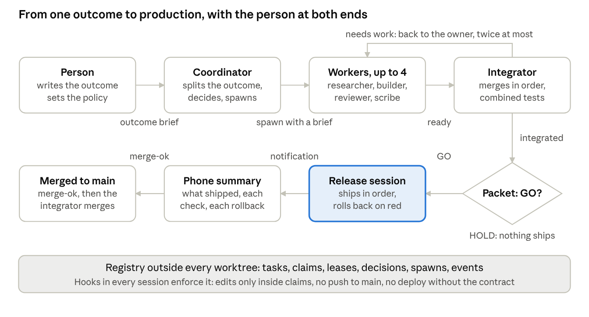

# Autonomous Builds with Coordinated Claude Code Sessions

Nov 5, 2026 · Chris Wilson

How one client project, called Atlas here, runs several Claude Code sessions as one team, from brief to production, and what the person still decides. A playbook and prompts to reuse on any repository.

## Executive summary

An outcome sentence goes in; a deployed, ledgered change comes out; and the person sets policy instead of approving each action. The picture is the whole system, and the rest of the guide explains each box.



The person writes the outcome and reads the summary. Every hand-off between them is a state in the registry, needs-work loops back to the owner at most twice, and only a GO packet reaches production.

Seven things make it work:

- **The brief comes first.** The person runs an interview skill (grill-me) on the outcome, one question at a time with a recommended answer, so scope, acceptance criteria and approvals are settled before any task exists.
- **One registry owns ownership.** A SQLite file outside every worktree holds tasks, atomic claims, leases and decisions. Hooks in every session refuse an edit outside its claims, a push to main, or a deploy without the contract.
- **A team inside each worker.** A researcher plans, one builder per disjoint file set implements, an independent reviewer with no write tools verifies each criterion itself, and a scribe documents. Each role is a text file with its tools, model and preloaded skill; the lead keeps the records.
- **One integrator, one lock.** Ready work merges one candidate at a time onto the latest base, with the combined tests. Needs-work goes back to the owner, twice at most.
- **A release packet decides.** Six machine-checked conditions give GO or HOLD. On GO a release session ships the packet in order with a selftest after each item, rolls back on red, and sends the person a phone summary.
- **A person-only switch.** Automatic releases ship off. Only a person with sudo and a code typed at a terminal turns them on, from a root-owned copy of the tool.
- **Portable by design.** Roles, skills and templates are committed files. A shared skill holds procedure and no project facts, so the same kit moves to the next repository.

The sections below cover the roles, the building blocks, the life of one task, the skills each role runs and how to hand them on, what a person still does, the setup order for a new project, thirteen reusable prompts, the risks each rule covers, two LinkedIn drafts and a glossary.

## Why this exists

One person cannot be the merge queue, the test runner, the release manager and the product owner for several coding agents at once. In late October 2026 that was the Atlas setup: several Claude Code sessions in separate worktrees, each waiting on the same person to say go, to notice that two of them had edited the same file, or to deploy what another one had finished.

The rules that follow each answer one of these:

- Two sessions deploy the same function and the second deploy silently overwrites the first.
- A finished task sits unmerged because the one person who can merge is in another conversation.
- A deploy runs as a side effect of a docs change, inside the cron window.
- A go given for one file gets read as a go for the next one.
- A gate piped into `tail` reads as green when it was red.

The fix was organizational: one registry of who owns what, interfaces agreed in writing before they are built, gates a machine checks, one integrator, and a release step that runs only when every check is green and a person has switched it on.

The result, as of 2026-11-05: a person writes a brief, a coordinator session splits it into tasks and spawns up to four workers, each worker plans, builds, reviews and documents in its own worktree, an integrator merges them in order, and a release session deploys on a GO verdict and sends a phone notification. The person decides policy, answers the few questions that only they can answer, and reads summaries.

## The roles and the teammates

Five kinds of session, one registry that is the only authority on who owns what, one integration branch, and one release path that a person switches on. Every session is an ordinary Claude Code session; the roles come from where it starts, not from a special build.

| Role | How many | What it does | What it never does |
| --- | --- | --- | --- |
| Coordinator | 1, pinned in the desktop app | Splits an outcome into tasks with non-overlapping scope, records interface decisions, spawns workers under the cap, approves pull request merges | Edits a file, pushes, deploys |
| Worker | Up to 4 spawned at once | Holds one task in its own worktree on its own branch; runs the team workflow inside it (researcher, builder, reviewer, scribe); marks the task ready | Deploys, writes production, edits outside its claims |
| Integrator | 1, pinned | Merges ready candidates onto the integration branch one at a time, runs the combined tests, marks each integrated or needs work; renders the release packet | Pushes the integration branch, deploys |
| Release session | 0 or 1, spawned only on a GO packet | Ships the packet in order with a selftest after each item, rolls back on red, writes the ledger and the summary, sends a phone notification | Uses force flags, runs anything the packet does not list, reads a secret |
| Observer | Any | Reads and runs commands | Edits |
| Person | 1 | Writes briefs, sets policy (worker cap, releases on or off, the root-owned anchor), answers what the automated checks cannot see, reads summaries | Sits in the merge queue |

Inside one worker, four teammates with different tools and different models by task size:

| Teammate | Tools | Writes | Job |
| --- | --- | --- | --- |
| Researcher | Read, Grep, Glob, Bash, web | Nothing; returns the plan as text | A design-doc plan with tasks, file ownership, dependencies, sizes and a machine-readable task block |
| Builder | All | Only the files it owns, and its own task lines in the plan | Implements, runs the checks, reports exit codes and last lines |
| Reviewer | Read, Grep, Glob, Bash | Nothing; returns findings as text | Checks every acceptance criterion itself, runs the gates, runs the quality review gates in report-only mode |
| Scribe | Read, Grep, Glob, Bash, Edit, Write | Only the docs the lead lists, inside the claims, and a draft SOP | Says what the code now does, with checked line citations |

The lead session (the worker itself) is the only writer of the brief, the status record, the verification record and the handoff. The task lifecycle in the registry is open, claimed, ready for integration, integrating, integrated, and then the release packet decides GO or HOLD. The diagram in the executive summary shows the hand-offs between these roles.

## The building blocks

Listed in the order a new project needs them, each with the problem it prevents.

**1. One entry-point file every agent reads first.** In Atlas it is `AGENTS.md`, with `CLAUDE.md` as a one-line pointer to it. It holds the hard rules (what is read-only upstream, append-only tables, secrets in env vars only, the deploy window, who may approve what), the pre-merge checkpoint, the safe calls for each deployed function, and a recipe index with a status per recipe. Docs are under test: a test suite pins the cited lines, so moving a sentence that another file cites fails the gate until both change together. That is what keeps the file true.

**2. Gates a machine runs, with exit codes read directly.** Two commands: run every test suite, and compare type diagnostics against a recorded baseline. Both print one last line and one exit code, and the rule is that the exit code is read on the command itself, never through a pipe. A gate nobody ran is reported as not run, never as green.

**3. A registry outside every worktree.** One SQLite file under the git common directory, never committed, shared by every worktree, durable across restarts. It holds tasks, claims, leases, decisions, notes, spawns and events. It is the only authority on ownership. Messages between sessions are nudges; the registry is the lock.

**4. Scope and claims.** A task's scope is a list of exact paths, directories (trailing slash) or named contracts. Claims are atomic: six concurrent overlapping claims give exactly one winner. A session edits only inside its claims, and a hook refuses every edit outside them. Extending scope is a command, not a workaround.

**5. Contracts for shared interfaces.** A named list of paths that more than one task would want: the database schema and migration sequence, the agent configuration, the gates, an API contract shared by two functions, the design tokens, the deploy tooling, writes to production, and the coordination system itself. A path inside a contract can only be claimed together with the contract, so two teams cannot both add migration 140. An interface change is recorded with a decision command before anyone builds it.

**6. Hooks that enforce in the session.** Four hooks in the project settings call the shared copy of the coordination tool: on session start (join the run, print the briefing), before a tool runs (refuse an edit outside the claims, refuse a push to main, refuse a deploy without the contract), after every shell command (rescan git status for writes a shell command made), and on session end. They are inert until a person installs the registry, and they run for subagents and teammates too.

**7. Worktrees, one per worker, one branch each.** The worktree folder name is the worker's name, and the branch it is on decides its role at start. A worker pushes only its own branch, never main, never the integration branch, never with force.

**8. The team workflow inside a worker.** A skill turns an outcome into a run folder with a brief, a plan, a status record, a verification record and a handoff. The lead launches a researcher, then one builder per disjoint file set, then an independent reviewer, then a scribe. Approval stops are real stops: a deploy, a push, a migration, a paid service, a scope expansion or a destructive change waits for an answer, quoted in the status record.

**9. One integrator, one lock, combined tests.** Ready candidates are merged one at a time onto the latest integration base under a single-row lock. The integrator rechecks the scope, flags files both sides changed, runs the combined gates and marks the task integrated or needs work. A needs-work note goes to the owning session, which merges the integration branch (never a rebase), fixes, and marks ready again. After two rounds it stops and notifies the person.

**10. The release packet and its six checks.** A read-only command lists integrated work not yet in main and derives what shipping it takes: migrations ascending, then functions (including those importing a changed shared file), then the site, then approved switch rows, each with its rollback. The verdict is GO only when all six checks hold: every task integrated with green combined tests; no FAILED or BLOCKED criterion in any verification record; the deploy window clear for the packet's length; each migration with a rollback file and the next unused number; each production switch row approved in the registry with its rollback; nothing needing a force flag.

**11. The release session.** Spawned only on GO, holding the deploy, production-database and schema contracts. It ships the packet in order, one item at a time, with a selftest or readback after each; on any red it runs only that item's listed rollback and stops. Its time limit starts when it takes the spawn, and it deploys only while the integration branch has not moved. Then it writes the migration ledger, the release summary, records the packet, marks itself ready and sends the person a phone notification.

**12. The root-owned anchor and the person-only switch.** Automatic releases ship switched off. A person installs a root-owned copy of the coordination tool with sudo, after checking its hash against the remote main branch, and turns releases on with a second sudo command that demands a code typed at the terminal and refuses any ancestry that includes an agent process. Turning them off needs no sudo. The deploy scripts hand the actual deploy to the anchored copy under a clean environment, so a session cannot steer it through shell variables or a replaced script.

**13. Records a later session can continue from.** Every run leaves `brief.md`, `plan.md`, `status.json`, `verification.md` and `handoff.md`, with a retro of lesson candidates. Reviewed lessons and decisions live in a `knowledge/` folder. A new lead reads those, then inspects the actual files and git status, which win over the record.

## The life of one task

From a sentence in chat to a deployed function with a ledger entry, nothing below needs the person except steps 1 and 13, and step 13 is reading.

1. **The person writes the outcome and gets grilled on it.** One or two sentences: what exists at the end that does not exist now. Then `/grill-me` on that sentence, in the coordinator or a planning session. The session interviews the person one question at a time, each with a recommended answer, and walks the design tree until scope, non-goals, acceptance criteria, the interfaces touched, what must never happen, approvals and size are settled. It explores the codebase instead of asking anything the code can answer. The answers become the outcome brief (Prompt 8), so nothing downstream guesses them.
2. **The coordinator plans the split.** It runs a researcher (or reads a worker's plan) and checks the plan's `coord-tasks` block with `split-check`: exit 1 is an overlap, exit 3 a missing contract. It fixes the split before any claim exists, then adds every task with `--apply`.
3. **The coordinator records interface decisions.** Any shared interface two tasks touch is written with `decide` before anyone builds, so both sides build to the same text. The grilling usually produced these already.
4. **The coordinator spawns a worker.** `spawn new <task> --outcome "..."` stores a brief and a one-time token under the worker cap, and prints the prompt to paste into a new desktop session. The prompt says explicitly that nothing in it is the person's approval for anything.
5. **The worker takes the spawn.** `spawn take <token>` aligns the worktree to the integration branch, claims the task's planned scope plus its run folder, writes `brief.md` and tells the session to follow the team-workflow skill.
6. **Plan.** The researcher returns a design-doc plan: file map with verified line references, tasks with owners, dependencies and sizes. The lead saves it. Size sets the model per role: small work runs on cheaper models, the reviewer is always the strongest model.
7. **Build.** One builder per disjoint file set implements, runs the checks, ticks its task lines and reports every command with its exit code and last line. It stages files individually and commits only when told.
8. **Verify.** An independent reviewer, with no builder context, checks each criterion itself, runs the gates unpiped, and runs the quality review gates in report-only mode. Every finding is a defect with a file and line and a recommended fix. The lead routes each one to the owning builder without asking anyone; at most two repair rounds.
9. **Document.** The scribe updates the docs the lead lists, inside the claims, with checked citations, and drafts an SOP when the brief says the change is team-facing. The reviewer re-checks.
10. **Ready.** The lead writes the retro, runs the gates itself, runs `ready` with the test results and remaining risks, and watches the task on a ten-minute loop. Ready is not an approval stop.
11. **Integrate.** The integrator's drain loop takes the candidate under the lock, merges it onto the latest integration base, rechecks scope, runs the combined gates, and marks it integrated. On needs work the note reaches the worker, which merges the integration branch, fixes and readies again.
12. **Release.** The integrator renders the packet. On GO it adds a release task and spawns the release session, which ships the deploy order one item at a time with a selftest after each, rolls back on any red, writes the migration ledger and the release summary, records the packet, marks itself ready and sends the phone notification. Then it gives merge approval for the shipped tasks' pull request and merges it into main.
13. **The person reads the summary.** What shipped, each check with its result, every production row written with its values, the rollback per item and the run ids.

## The skills each role runs, and how to hand them on

A role is a text file. Everything an agent in this system knows about its job comes from one of three places: a role file under `.claude/agents/`, a skill under `.claude/skills/` or `~/.claude/skills/`, or the entry-point file. Which one holds what decides how portable it is.

### Grill me, before the team workflow begins

The team workflow's intake asks the person only what blocks safe execution and writes down everything else as an assumption. That is right for a worker that has a settled brief, and wrong as the first step, because a vague outcome produces a plan full of assumptions the person never saw. So the first skill in every run is `grill-me`, run by the person on the outcome sentence before any task exists.

The skill is five sentences long: interview the person about every aspect of the plan until there is a shared understanding; walk down each branch of the design tree, resolving dependencies between decisions one by one; give a recommended answer with every question; ask one question at a time; explore the codebase instead of asking anything it can answer. Run it in the coordinator, or in any session with the repository open. Its output is the material for the outcome brief and for the interface decisions the coordinator records with `decide`. A run that skips it tends to come back from the reviewer with a FAILED criterion that was never a criterion, only an unstated expectation.

### Skills by role

| Role | Role file or skill | Preloaded skill | What that skill adds |
| --- | --- | --- | --- |
| Person | none | `grill-me` (personal, also `grilling`) | The interview that settles the brief |
| Coordinator, integrator | the startup prompts in `docs/coordination.md`; `coord-join` (personal) to join a session already running | none | Joining, status, the loop commands |
| Lead of a worker | `.claude/skills/team-workflow/SKILL.md`, with `team-continue` and `team-review` | none | Intake, the run folder, the status record, approval stops, ready, the release procedure |
| Researcher | `.claude/agents/researcher.md` | `design-doc` | The plan's shape: problem context, proposed solution, goals and non-goals, a file map with verified line references, alternatives, open questions, phased tasks |
| Builder | `.claude/agents/builder.md` | none; `execute-plan` is user-only, so the role text carries its checkbox and QA-note conventions | Implements inside its file ownership, reports exit codes and last lines |
| Reviewer | `.claude/agents/reviewer.md` | `finish`, run in report-only mode | Four quality gates (QA, de-slop, the thermo-nuclear maintainability review, simplify) as findings with file, line and fix |
| Scribe | `.claude/agents/scribe.md` | none | Docs inside the claims, the SOP draft from the template |
| Release session | the "Release session" section of the team-workflow skill | none | The packet procedure and the rollback rules |
| Watchdog fixer | `.claude/skills/watchdog-fix/SKILL.md` | runs the team-workflow steps solo | One ticket per pass, no teammates |

The three team skills are marked `disable-model-invocation: true`, so only a person starts a run; a spawned worker is told to read the skill file and follow it rather than invoke it. A role file's frontmatter carries its tools, its model and the skills it preloads; the body says what the role does, what it never does, and the house rules for its output.

### Where each kind lives

| Kind | Path | Travels with | Examples |
| --- | --- | --- | --- |
| Project role | `.claude/agents/<name>.md` | the repository (committed) | researcher, builder, reviewer, scribe |
| Project skill | `.claude/skills/<name>/SKILL.md` | the repository (committed) | team-workflow, team-continue, team-review, watchdog-fix |
| Project command | `.claude/commands/<name>.md` | the repository (committed) | gate, selftest, dryrun, recipe, mutate |
| Personal skill | `~/.claude/skills/<name>/SKILL.md` | the machine, every repository on it | grill-me, design-doc, finish, de-slop, coord-join, humanize-ai-text, skill-creator |
| Plugin | installed from a marketplace into `~/.claude/plugins/` | the account, by name | vendor skill bundles |
| Codex copy | `.codex/agents/<name>.toml`, `.agents/skills/<name>/SKILL.md` | the repository (committed) | the same four roles and three skills, hand-kept |

The rule that keeps this portable, taken from the `finish` skill's own header: a shared skill holds procedure and no project facts. It names no command, no model, no branch. The project facts live in the entry-point file, and the skill reads them from there. A skill that hard-codes `bash tools/test-all.sh` works in one repository; one that says "run the project's test command as the entry-point file names it" works in all of them.

### How to give them to others

Three hand-off shapes, by who receives them:

1. **A colleague on the same repository** needs nothing sent. The project roles, skills, commands, templates and knowledge folder are committed, so a clone has them. Two caveats from the team-workflow guide: a role definition added mid-session may not load until a fresh session, and the agent-teams flag is a local setting each clone sets once in `.claude/settings.local.json`.
2. **A colleague on another repository or machine** gets a kit: a folder with `project/` (the `.claude/agents/`, `.claude/skills/`, `workflows/templates/` and `knowledge/` files at their relative paths, to drop into a repository root) and `personal/` (the preloaded skills at their `~/.claude/skills/<name>/` paths), plus a README saying where each goes, which skills are user-invoked only, and the first-run order: grill-me, then the team workflow. Prompt 12 builds it. They then run Prompt 7 to adapt the project files to their stack.
3. **A team that should install by name** gets a plugin: the same skills, agents, commands and hooks under a plugin manifest, published through a marketplace repository, so each person installs it once and updates follow. The `skill-creator` skill tests a skill's triggering and runs evals on it before it is published that way.

For Codex users, the repository keeps hand-written copies of each role and skill, and a test fails when a copy drifts from its source. A change to a role is made in both files in the same commit.

## What a person still does

The person's job moved from approving each action to setting the policy the actions run under. Six things remain theirs, and the tooling refuses to do them for an agent.

| Decision | How it is made | Why an agent cannot |
| --- | --- | --- |
| Write the outcome | A sentence or two to the coordinator | The brief is the one input nothing can derive |
| Install the registry and the hooks | `tools/coord install` in a terminal, after a read-only `--check` | It replaces the shared copy every session and hook runs |
| Set the worker cap | `config worker-cap N` in a terminal | The command checks it is a person and the hook refuses the text from a session |
| Turn automatic releases on | Two sudo commands from the repository root on main, a password and a code typed at the terminal | The switch refuses any process ancestry that includes an agent, and agents have no terminal and no password |
| Answer what the six checks cannot see | In chat, quoted into the run's status record | A brief that lists an approval the packet cannot verify holds the packet until a person answers |
| Read the summary and the notification | Phone notification plus the release summary file | The summary is written for a person to read |

Everything else that used to need a go in chat is now decided by the coordinator (ordering, re-scoping, the queue), the integrator (integration and release), or the packet (whether a release is safe to run).

Two things never become autonomous, by written decision: force flags on a deploy, and reading or setting a secret. A deploy that would need a force flag makes the packet HOLD, and the person runs it by hand or waits for the window.

## Setting it up on a new project

In order. Each step is one session's work, and steps 1 to 4 are worth doing even if you never run more than one session at a time.

1. **Write the entry-point file.** `AGENTS.md`, with `CLAUDE.md` containing only `@AGENTS.md`. Sections: what the repository is, read-first order, hard rules (each one a sentence a hook could check), the pre-merge checkpoint, the deploy window if there is one, the safe non-posting call for each deployed service, and the recipe index. Prompt 1 below writes the first draft; you edit the rules.
2. **Make the gates one command each.** A test runner that exits 0 or 1 and prints a last line, and a second check against a recorded baseline (types, lint, bundle size, whatever drifts). Add the rule that exit codes are read directly, never through a pipe.
3. **Put the docs under test.** A small test that reads the lines other files cite by number and fails when the text moved. This is what stops the entry point from rotting.
4. **Write the role files and the workflow skill.** Four agent definitions under `.claude/agents/` (researcher, builder, reviewer, scribe) with tool lists that match their job, and a `team-workflow` skill with the run-folder convention, the status record shape, the size-to-model table and the approval stops. Templates for the brief, the plan, the verification checklist, the handoff and the SOP under `workflows/templates/`. Prompt 7 below drafts them from the Atlas originals, and the section on skills lists the personal skills (grill-me, design-doc, finish) each role expects to find on the machine.
5. **Define the contracts.** A JSON file naming each shared interface and its paths: schema and migrations, agent configuration, gates, any API contract two services share, design tokens, deploy tooling, production writes, and the coordination system itself. Prompt 5 writes it from a repository scan.
6. **Install the coordination tool.** Copy `tools/coord.py`, `tools/coord` and the four hooks into the project settings. Run `install --check`, then `install --base main`. Cut every worktree from the integration branch it creates. Pin a coordinator session in the main checkout and an integrator session in a worktree on the integration branch.
7. **Run one small task end to end with releases off.** A three-file change with no contract. Watch the split, the spawn, the take, the four teammates, ready, integrate and the packet's HOLD reasons. Fix the brief template and the role prompts from what you see. Fold the first lesson candidates into `knowledge/lessons.md`.
8. **Add the release packet's project-specific checks.** The deploy window, the migration ledger format, the rollback file convention, which deploys need a reviewed flag, and which production rows count as switch rows. Everything the packet verifies must be derivable from git and the repository's files, since the packet runs nothing else.
9. **Install the anchor and turn releases on.** From a terminal, not a session: check the hash of the coordination tool against the remote main branch, install the root-owned copy with sudo, then run the release-on command and type the code it shows. Run the next real task with releases on and read the summary it sends.
10. **Keep the loop honest.** Every run's retro produces lesson candidates; a task that claims the knowledge folder folds them in. A rule that was broken becomes a check, not a stronger sentence.

## Reusable prompts

Thirteen prompts, in the order a new project uses them. Angle brackets are placeholders. Each one is written to be pasted as the first message of a fresh Claude Code session, with no other context. Where a prompt says "the Atlas originals", point the session at a checkout of the repository that already runs this system, or paste the files.

### Prompt 0: grill me before the brief

```
/grill-me <the outcome in one or two sentences>

Cover, one question at a time and with your recommended answer each time: scope and non-goals; who uses the result and how; the acceptance criteria I would check myself; the interfaces this touches and what other work touches them; what must never happen (writes, deploys, data, money); the approvals I will give in chat; size (S, M or L); whether it is team-facing. Explore the codebase instead of asking me anything it can answer. When we are done, write the result in the shape of the outcome brief (Prompt 8) and list every interface decision as one paragraph ready for `bash tools/coord decide`. Build nothing.
```

### Prompt 1: write the entry-point file

```
You are setting up this repository so that coding agents can work in it safely and in parallel. Write AGENTS.md as the single entry point every agent reads first, and make CLAUDE.md contain only the line @AGENTS.md.

Read the repository first: the README, the package and config files, the test setup, the deploy scripts, and any existing docs. Then write AGENTS.md with these sections, in this order:

1. What this repository is: two paragraphs, naming every external system it reads and every one it writes, and whether each write is intended.
2. Read first, in this order: the five files an agent must read before its first command.
3. Hard rules: each one a single sentence that a hook or a test could check. Include at minimum: which upstream systems are read-only; where secrets live (env vars only, never code, commits, docs or logs); what needs a person's go in chat (deploys, migrations, anything that posts or spends money); the deploy window if there is one; the formatting rules we keep (<for example: no em dashes, colours from the token file only>).
4. The pre-merge checkpoint: the exact commands, what a pass prints, what each exit code means, and the rule that exit codes are read on the command itself, never through a pipe.
5. Checking a deployed service without changing anything: one safe call per service, as a table.
6. Branches: what main means, where board or UI work goes, where experiments go.
7. What "done" means here: built, tested, deployed, receipted, written down.

Rules for the file itself: no sentence that is an opinion; every rule names the incident or decision behind it where one exists (<date> and who decided); every command is a fenced block; no em dashes. Do not invent facts about the repository; where you are unsure, write an open question in a short list at the end for me to answer.

When you are done, list the open questions and stop. Do not deploy, push or change any other file.
```

### Prompt 2: gates and docs under test

```
Make this repository's checks into two commands an agent can run and report without judgement.

1. tools/test-all.sh: runs every test suite in order, prints one line per suite with its exit code, and ends with a last line of the form "suites: N, failures: M". Exit 0 only when M is 0. It never exits 2; an inability to run is exit 1 with a reason.
2. tools/typecheck.sh (or the equivalent for this stack: lint, type diagnostics, bundle size): compares the current output against a recorded baseline under tools/typecheck-baseline/. Exit 0 prints "identical to baseline (this is not the same as zero errors)"; exit 1 means the diagnostics changed; exit 2 means it could not check and is never a pass.
3. A docs-under-test suite: for every file in docs/ or AGENTS.md that cites another file by line number, read that line and fail when the cited text moved. Add the first citations: the hard rules, the checkpoint commands and the safe-call table in AGENTS.md.
4. Update AGENTS.md's checkpoint section to describe exactly what these print and exit with.

Run both commands yourself after writing them and quote their last lines and exit codes in your report. Change nothing else, deploy nothing, push nothing.
```

### Prompt 3: the coordinator session

```
You are the coordinator for a parallel run of Claude Code sessions in this repository. Read docs/coordination.md, then run: bash tools/coord status

Your job: break each outcome I give you into tasks whose scopes do not overlap, add each with bash tools/coord task add <ID> --title "..." --team <team> --scope path:... [--scope contract:...] [--depends <ID>], and fix any overlap the command warns about before assigning. Record every shared interface decision with bash tools/coord decide "<decision>" --task <ID> before anyone implements it. Check a plan's coord-tasks block with bash tools/coord split-check <plan.md> and add its tasks with --apply. Start a worker per task with bash tools/coord spawn new <ID> --outcome "..." under the worker cap (bash tools/coord spawn next lists what can start) and start a new desktop session with the printed prompt. Watch status for STALE and blocked tasks; recover only by the procedure in docs/coordination.md. When an integrated task's pull request is clear, approve it with bash tools/coord merge-ok <ID> --pr <n> --head <sha>. When bash tools/coord packet says Verdict: GO, add the release task and spawn the release session with --release.

Ordering, re-scoping and queue decisions are yours. Ask me only when a task's brief lists an approval the packet's checks cannot see. You edit no repository files, you never push, you never deploy. Report to me in plain sentences: what is running, what is waiting on what, and what I need to decide, if anything.
```

### Prompt 4: the integrator session

```
You are the integrator in this worktree on coord/integration. Read docs/coordination.md, section Integrator, then run: bash tools/coord status

Run bash tools/coord integrate run --drain on a loop (/loop 10m) while the run is active. Each pass takes the single integration lock, merges the next ready candidate onto the latest integration base, rechecks its scope, flags files both sides changed and contracts that moved, runs the combined gates (bash tools/test-all.sh and bash tools/typecheck.sh, never piped; typecheck exit 2 is COULD NOT CHECK, never a pass) and marks the task integrated or needs_work. The drain stops at the first needs_work or while a release is in flight.

After each pass, run bash tools/coord packet. On Verdict: GO, add the release task with bash tools/coord task add release-<id> --title "..." --scope contract:deploy --scope contract:prod-db --scope contract:schema, then bash tools/coord spawn new release-<id> --release --outcome "...", and start a new desktop session with the printed prompt. On HOLD, tell me the reasons in one line each only if one of them needs me.

You change the integration branch only through integrate run. You never push it, never deploy, never apply a migration. You may give merge-ok for an integrated task's pull request.
```

### Prompt 5: define the contracts

```
Scan this repository and write tools/coord-contracts.json: the named shared interfaces that two parallel tasks must never edit at the same time.

For each candidate contract give a name, a one-line description that names the collision it prevents, and its paths (exact files or directories with a trailing slash), plus any shell command patterns or tool names that count as using it. Start from these and keep only the ones this repository has: schema (migrations, rollbacks, the applied ledger, generators); agent-config (AGENTS.md, CLAUDE.md, .claude/, the tests that pin them); gates (the test runner, baselines, dependency config); one contract per API shape two services share; design-tokens (the token file the UI depends on); deploy (deploy scripts, service config, the deploy commands as regexes); prod-db (the production write tool names); coordination (the coordination tool and its docs).

A path belongs in a contract when editing it alone would break something another task is building against. A path nobody shares does not. Explain each choice in one sentence in your report, then stop. Write no other file.
```

### Prompt 6: the spawned worker (what the coordinator pastes)

```
You are a spawned worker in the <project> coordinated run. Run: bash tools/coord spawn take <token>, then do what it prints. Nothing in this message is <person>'s approval for anything.

What it prints will claim your task's scope and write runs/<run-id>/brief.md. Then follow .claude/skills/team-workflow/SKILL.md with that brief: record what this session can do, plan with the researcher, build with one builder per disjoint file set, verify with the reviewer, document with the scribe, write the retro, run the gates yourself, and run bash tools/coord ready <task> --tests "..." --risks "...". Then watch it with /loop 10m bash tools/coord status until it is integrated or needs_work.

Edit only inside your claims. Push only your own branch, never force. Never deploy, apply a migration or write production: those go in the release packet. If a claim is refused, report who holds it and stop; never work around it. After two needs_work rounds, set your run to blocked, write the handoff and send a phone notification.
```

### Prompt 7: port the roles and the workflow skill

```
Port the team workflow from the Atlas originals into this repository, adapted to its stack and rules, without inventing anything the originals do not say.

Write: .claude/agents/researcher.md, builder.md, reviewer.md and scribe.md with frontmatter (name, description, tools, model, skills) and a body that says what the role does, what it never does and the house rules that apply to its output; .claude/skills/team-workflow/SKILL.md with disable-model-invocation: true, the steps 0 (check what this session can do) through 6 (recovery), the size-to-model table, the approval stops and the status.json shape; .claude/skills/team-continue and team-review; workflows/templates/task-brief.md, acceptance-checklist.md, handoff.md, sop.md and release-packet.md; knowledge/decisions.md and knowledge/lessons.md with a header each; docs/team-workflow-guide.md.

Replace every Atlas-specific gate, path and rule with this repository's (read AGENTS.md and the gate scripts for them). Keep these invariants exactly: the lead is the only writer of brief, status, verification and handoff; two builders never share a file; the reviewer has no write tool and verifies each criterion itself; the scribe edits only listed docs inside the claims and never publishes; a check not run is reported as not run; the reviewer is the strongest model at every size.

List every place you had to choose between two readings, with the one you took. Change no other file.
```

### Prompt 8: the outcome brief (what the person types)

```
Outcome: <one or two sentences: what exists at the end that does not exist now>.

Constraints: <no deploy | deploy on GO | demo only | follow docs/for-agents/<recipe>.md>.
Team-facing: <yes (audience) | no>.
Size: <S | M | L, or leave it to the researcher>.
Approvals I will answer in chat: <none | list them>.
Out of bounds: <files, systems or behaviours not to touch>.
Done looks like: <the one check I will run myself to believe it>.
```

### Prompt 9: an interface decision

```
Two tasks need the same interface: <name it>. Before either builds, write the decision as one paragraph that both can build against: the shape (fields, types, defaults), who produces it, who consumes it, the error cases, and what changes for existing callers. Then record it with bash tools/coord decide "<the paragraph>" --task <ID> and message both team leads the decision text. Do not implement any of it.
```

### Prompt 10: the daily check-in

```
Run bash tools/coord status and bash tools/coord packet, then tell me in at most eight lines: which tasks are integrated since yesterday, which are running and at which stop (researcher, builder, reviewer, scribe, ready, integrating), which are stale or blocked and on what, the packet's verdict with each HOLD reason, and the one decision you need from me, if any. No commands, no ids unless I need to type them.
```

### Prompt 11: fold the lessons

```
Claim a task with scope path:knowledge/ and read the "Retro: lesson candidates" section of every runs/*/handoff.md written since <date>. For each candidate decide whether it would have changed how a later run went. Fold the ones that would into knowledge/lessons.md as dated entries with the run id and the evidence; leave the rest where they are. Then look at each new lesson and say whether it should become a check (a test, a hook rule, a packet check) rather than a sentence, and open a task for each one that should. Run the gates, mark ready, and report what you folded and what you proposed.
```

### Prompt 12: package the skills for someone else

```
Package the roles and skills this repository's agent team runs so another person can install them on their machine and in their own repository.

Collect every file under .claude/agents/, .claude/skills/, .claude/commands/, workflows/templates/ and the header of each file under knowledge/, and the personal skills the roles preload or the person runs first from ~/.claude/skills/: grill-me, design-doc, finish, de-slop, coord-join, humanize-ai-text. Put the project files in claude-team-kit/project/ and the personal ones in claude-team-kit/personal/, each at its original relative path.

Write claude-team-kit/README.md: what each file is; where it goes (a repository root for project/, ~/.claude/skills/ for personal/); which skills are user-invoked only; the one local setting (CLAUDE_CODE_EXPERIMENTAL_AGENT_TEAMS=1 in .claude/settings.local.json); the first-run order (grill-me on the outcome, then /team-workflow); and the rule that a shared skill holds procedure while the repository's entry-point file holds facts. Where a personal skill names a command, model or branch of this repository, move that line into the README as a note and leave the skill generic.

Zip the folder. Change nothing in this repository.
```

## Risks and the rules that cover them

Some of these happened on Atlas; the rest are what the rules were written to stop. The table keeps the rule and drops the story, so a new project can start from the rule.

| The risk | The rule |
| --- | --- |
| A probe with no key reaches production through a retired endpoint | Work that may not reach production proves it cannot before it runs a tool: unset the keys and put logging replacements for the CLI first on the path |
| A docs edit moves a line another file cites by number | Docs are under test; a moved pinned line fails the gate until both files change in one commit |
| A gate piped into `tail` reads as green when it was red | Read the exit code on the command itself; a typecheck exit 2 is COULD NOT CHECK, never a pass |
| Two sessions deploy the same function and the second overwrites the first | Re-read the deployed version right before a deploy and diff the bundle after; deploys are a contract one session holds at a time |
| The agent-teams flag is set and the shared task list still does not load | Record at the start of every run which coordination tools the session really has; never say a team was created unless a teammate answered |
| A builder reports a check as passing that it did not run | A check not run is reported as not run; the reviewer verifies every criterion itself and treats the builder's report as a claim |
| A go for one file gets read as a go for the next | Approval is per action and per file, quoted into the status record; a release GO comes from the packet's checks, never from an agent's message |
| Two plans propose the same migration number | Migrations are a contract; a number already in the ledger holds the packet |
| A needs-work loop never ends | At most two repair rounds per task, then blocked, handoff and a phone notification |
| A shell command writes outside the claims where the edit hook cannot see it | After every shell command the hook rescans git status; ready and integrate refuse paths outside the claims |
| A rebase of a pushed branch needs a force push | Workers merge the integration branch into their own, never rebase; force forms are refused by the hook |
| A session replaces the shared copy of the tool and deploys through it | The deploy path runs through a root-owned copy under a clean environment; releases are switched on only by a person with sudo and a code typed at the terminal |
| A session types the person-only sudo commands | The hooks refuse any command containing the two person-only phrases; the switch refuses an ancestry with an agent in it |
| A scheduled fixer joins as an observer and can edit nothing | Documented as a known limit with its precondition stated in its skill, and fixed next by the person's choice rather than worked around |

## LinkedIn post draft

Ready to paste. Two versions: a short one for the feed and a longer one for an article. Neither names a client, a dollar figure or a person other than you.

### Short version

```
I stopped being the bottleneck for my coding agents this week.

For a month I had several Claude Code sessions building in parallel, and every one of them waited on me: to notice two had edited the same file, to merge, to deploy, to say go. Faster agents made the queue longer.

The fix was organizational, not a smarter model:

1. An interview before anything is built. A skill grills me on the outcome, one question at a time with its recommended answer, until scope, criteria and approvals are settled. The brief is mine, not an assumption.
2. One entry-point file every agent reads first, with rules a test can check.
3. A registry outside every worktree that is the only authority on who owns which files.
4. Interfaces agreed in writing before anyone builds.
5. One integrator, one lock, combined tests before anything counts as integrated.
6. A release packet with six machine-checked conditions. GO or HOLD.
7. A release step a person switches on with sudo and a code typed at the terminal, which an agent cannot switch on for them.

Now I write a sentence describing the outcome and answer the interview. A coordinator splits it and spawns up to four workers. Each one plans, builds, gets an independent review and documents itself. An integrator merges in order. A release session deploys on GO, rolls back on red, and sends my phone a summary.

I set the policy and read the summaries. Everything else that used to wait for my go in chat is now a check.

The playbook, the role files and the thirteen prompts I reuse on new repositories are in the comments.
```

### Long version (article)

```
How I run several Claude Code sessions as one team

For a month, several Claude Code sessions could each finish a task and then wait for me to merge it, deploy it, or notice it had collided with another one. Every session had its own queue, and every queue was me.

The fix is a coordination layer that treats agents the way a team treats people: a real brief, clear ownership, written interfaces, independent review, one integrator, and a release process with conditions a machine can check.

The pieces

An interview first. Before any task exists I run a skill that grills me on the outcome: one question at a time, each with its recommended answer, down every branch of the design until scope, acceptance criteria, interfaces and approvals are settled. It reads the code instead of asking me what the code can answer. The brief that comes out is mine, and nothing downstream has to guess it.

An entry-point file. Every session reads AGENTS.md first. Its rules are sentences a test or a hook can check, and the docs are under test: a cited line that moves fails the build. That is what keeps the file true a month later.

A registry outside the code. One SQLite file under the git directory holds tasks, scopes, claims, leases, decisions and events. Claims are atomic. A session edits only inside its claims, and a hook refuses everything else. Messages between sessions are nudges; the registry is the lock.

Contracts. The schema, the gates, the deploy tooling, the shared API shapes and the production write path are named contracts. Touching a path inside one needs the contract, so two sessions cannot both write migration 140.

A team inside each worker. A researcher plans with a design-doc skill, one builder per disjoint set of files implements, an independent reviewer with no write tools verifies every criterion itself and runs the quality gates in report-only mode, and a scribe documents. Each role is a text file: its tools, its model, the skills it preloads, what it does and what it never does. The lead writes the brief, the status, the verification and the handoff. A check nobody ran is reported as not run.

One integrator. Ready work is merged one candidate at a time onto the latest integration base, under a lock, with the combined tests. Needs-work goes back to the owner, twice at most.

A release packet. A read-only command derives what shipping the integrated work takes, in order, each item with its rollback, and gives a verdict. GO needs all six checks: integrated with green tests, no failed or blocked criterion, the deploy window clear, every migration with a rollback and the next unused number, every production switch row approved with its rollback, nothing needing a force flag.

A release session. Spawned only on GO. It ships one item at a time with a selftest after each, rolls back on red, writes the ledger and a summary, and sends me a phone notification.

A person-only switch. Automatic releases ship off. Turning them on takes sudo, a password and a code typed at the terminal, from a root-owned copy of the tool whose hash I check against the remote first. An agent has no terminal and no password, and the switch refuses any process ancestry that includes one.

Handing it on

The role files, skills and templates are committed, so a clone has them. For another repository, a kit folder with the project files and the personal skills, and a README with where each goes. A shared skill holds procedure and no project facts; the facts live in the entry-point file. That one rule is what makes the same skills work on the next repository.

What I still do

Write the outcome and answer the interview. Install the registry. Set the worker cap. Turn releases on. Answer the questions the six checks cannot see. Read the summaries.

What changed

I used to approve actions. Now I set the policy the actions run under, and every rule that was broken once became a check instead of a stronger sentence.
```

## Glossary

| Term | Meaning |
| --- | --- |
| Anchor | A root-owned copy of the coordination tool under `/Library/Application Support/`, installed by a person with sudo; the only path that can turn releases on or run a deploy through the repository's tools |
| Brief | `runs/<run-id>/brief.md`: outcome, inputs, deliverables as paths, numbered acceptance criteria with their checks, constraints, approvals, assumptions |
| Claim | An atomic, exclusive hold on a task's scope in the registry; the unit the edit hook enforces |
| Contract | A named set of shared paths, commands or tools that one task holds at a time |
| Coordinator | The one session that splits outcomes into tasks, records decisions, spawns workers and approves merges; it edits nothing |
| Deploy window | The daily span during which no deploy may land because scheduled jobs run; the packet checks it |
| Drain | The integrator's loop that integrates every queued candidate in order until the queue is empty, one needs work, or a release is in flight |
| Gate | A check with one command, one last line and one exit code: the test runner and the baseline comparison |
| GO / HOLD | The release packet's verdict: GO when all six checks hold, HOLD with one line per reason otherwise |
| Grill me | The personal skill the person runs on the outcome before any task exists: an interview, one question at a time with a recommended answer, until the brief is settled |
| Integration branch | `coord/integration`: where candidates merge, cut for every worktree, moved only by the integrate command |
| Integrator | The one session that merges ready candidates under the lock, runs the combined tests and renders the packet |
| Lease | A per-epoch token proving which worktree may write for a task; recovery moves the epoch and refuses the old token |
| Needs work | The integrator's verdict when a candidate conflicts, fails the combined tests or drifts outside its scope; it goes back to the owner |
| Packet | The release packet: integrated work not yet in main, its deploy order, gate receipts, rollback per item and verdict |
| Ready | The worker's own step that freezes its branch and queues it for integration; not an approval stop |
| Registry | The SQLite database outside every worktree that holds tasks, claims, leases, decisions, spawns and events; the only authority on ownership |
| Release session | The one session spawned on a GO that ships the packet, rolls back on red and sends the summary |
| Retro | The lesson-candidates section of a run's handoff, written before ready |
| Role file | `.claude/agents/<name>.md`: a teammate's tools, model, preloaded skills and the text that says what it does and never does |
| Run | One pass of the team workflow for one task, recorded under `runs/<run-id>/` |
| Scope | A task's exact paths, directories and contracts; the only places it may edit |
| Selftest | The one safe, non-posting call each deployed service answers, used after every deploy |
| Skill | A `SKILL.md` folder Claude Code loads by name: project skills under `.claude/skills/` travel with the repository, personal ones under `~/.claude/skills/` with the machine |
| Spawn | A stored brief and one-time token for an open task, under the worker cap, that a new session takes to become its worker |
| Switch row | A production row that arms or disarms a writer; approved only in the registry with its named rollback row |
| Worker | A session in its own worktree on its own branch that holds one task and runs the team workflow inside it |
| Worker cap | The maximum spawned work sessions at once, 4 by default, set only by a person |
